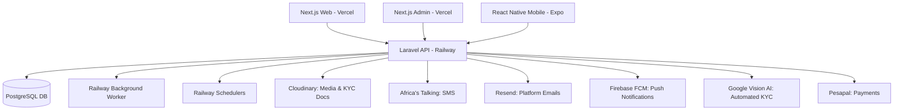

# Find My Home — Comprehensive Platform Documentation

Welcome to the **Find My Home** project! This document provides a complete overview of the platform, its architecture, key features, and critical security implementations. 

For setup and deployment instructions, please refer to the specific guides:
- [Local Development Setup](LOCAL_SETUP.md)
- [Docker Setup](README.docker.md)
- [Production Deployment](DEPLOY.md)

---

## 🏗️ Architecture Overview

Find My Home is a full-stack platform consisting of four main components, powered by a robust set of third-party integrations.

### Core Components
1. **Backend API (Laravel 10+)**: The central brain of the platform. Handles all business logic, database interactions, API endpoints, background workers for KYC processing, and cron jobs (schedulers).
2. **Web Frontend (Next.js)**: The main user-facing portal where buyers can browse properties, and sellers can manage their profiles and listings.
3. **Admin Panel (Next.js)**: A dedicated dashboard for platform administrators to manage users, manually approve KYC documents, handle disputes, and configure platform settings (e.g., commission rates).
4. **Mobile App (React Native / Expo)**: A cross-platform mobile application providing the core browsing, chatting, and listing functionalities on the go.

### Infrastructure & Integrations

---

## ✨ Key Features & Business Logic

### User Roles
- **Buyer**: Can browse listings, save favorites, send enquiries, and contact sellers via WhatsApp.
- **Individual Seller (e.g., Land Seller, Short Stay Host)**: Can list properties. Rules apply based on the category (e.g., Land listings require a title document, Short Stay requires light KYC).
- **Company**: Registered real estate agencies. They receive a verified "Blue Badge" upon successful KYC approval.
- **Admin**: Full control over platform operations.

### Core Workflows
- **KYC (Know Your Customer)**: Sellers must verify their identity. Documents are uploaded securely and analyzed first by **Google Vision AI** for automated processing. If the AI fails or the document requires human review, an Admin can manually approve it.
- **Commissions Enforcement**: The platform tracks lead conversions. The backend scheduler enforces commission due dates, sending reminders via Email, SMS, and Push Notifications. Users with unpaid commissions past the threshold are automatically blocked from adding new listings.
- **Duplicate Detection**: The background worker scans new listings to prevent spam and duplicate property postings.

---

## 🔒 Security Summary

Security is deeply integrated into Find My Home to protect user data, financial transactions, and highly sensitive KYC documents (passports, national IDs).

### 1. Document & Media Security (Cloudinary)
We use two strictly separated environments for uploads:
- **Public Property Photos**: Uses an `unsigned` upload preset. These images are publicly accessible and safe to distribute.
- **Sensitive KYC Documents**: Uses a **`signed`** upload preset. 
  - The access mode is set to **Private**, meaning documents are strictly inaccessible to the public. 
  - They can only be retrieved by the backend or authorized admins using authenticated requests.
  - *Never change KYC upload presets to unsigned.*

### 2. Authentication & Authorization
- Robust session management and token-based API authentication (utilizing Laravel's first-party auth packages).
- Role-Based Access Control (RBAC). Admin routes and web pages are rigorously protected.
- Never run `php artisan key:generate` on a live production server, as it invalidates all encryption keys and user sessions simultaneously.

### 3. Payment Security (Pesapal)
- Standardized IPN (Instant Payment Notification) webhooks.
- No sensitive credit card or mobile money details are stored on Find My Home servers; everything is handled securely by Pesapal.

### 4. Application Level Hardening
- **Validation**: Strict server-side validation on every incoming API request.
- **Environment Variables**: Sensitive keys (DB passwords, API keys) are kept out of source control. Reference the `.env.example` file and Railway/Vercel environments.
- **Rate Limiting**: API endpoints are securely rate-limited to prevent brute force and DDoS attacks. 

---

## 🧑‍💻 Development Best Practices

- **Testing**: Ensure that `APP_ENV=local` and `APP_DEBUG=true` are ONLY used in local environments. Production must strictly use `APP_ENV=production` and `APP_DEBUG=false`.
- **Database Migrations**: Always test migrations locally. Use `php artisan migrate:fresh --seed` to reset your local database safely.
- **Environment Parity**: Always refer to the `.env.example` in respective repositories to ensure your local environment matches production capabilities (even when stubbed).
